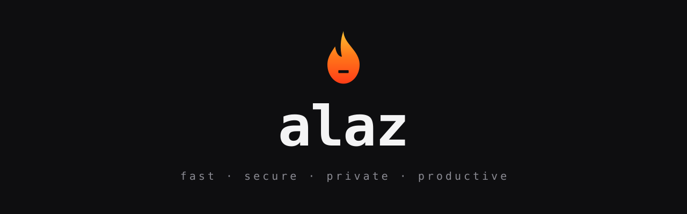

<p align="center">
  
</p>

# Alaz


A hobby operating system for x86_64, written from scratch in C and assembly. That includes its own bootloader, so nothing is borrowed from GRUB or any other existing OS.

## What does "Alaz" mean?

In Turkic mythology, **Alaz** (also called *Alaz Han*) is the god of fire. Fire is fast, it purifies whatever it touches, and it can't be handled carelessly. Those are the qualities this OS is aiming for:

| Fire is...        | Alaz should be...                                              |
| ----------------- | -------------------------------------------------------------- |
| **Fast**          | Lightweight and quick, with no wasted cycles                  |
| **Hard to touch** | Secure by design, so your system is protected from misuse     |
| **Purifying**     | Private, with no telemetry, no tracking and nothing hidden     |
| **A tool**        | Productive, so it gets out of your way and lets you work      |

## Why?

Alaz is mainly a **learning project**. The goal is to understand how a computer really works, from the first instruction the CPU runs after power-on up to a usable system, by building every layer by hand, one step at a time.

It won't replace Linux or macOS. It's meant to be readable, well commented, and easy to follow if you're learning too.

## Status

Very early. Alaz currently has a 512-byte boot sector that prints a message using the BIOS.

### Roadmap

- [ ] Boot sector: 16-bit real mode, print to screen via BIOS
- [ ] Load more sectors from disk
- [ ] Enter 32-bit protected mode (GDT)
- [ ] Enter 64-bit long mode (paging)
- [ ] Jump into a C kernel
- [ ] VGA text output, `printf`
- [ ] Interrupts (IDT) and keyboard input
- [ ] Physical and virtual memory management
- [ ] Multitasking
- [ ] A filesystem
- [ ] A shell
- [ ] A graphical desktop

## Build and run

You'll need [NASM](https://www.nasm.us/) and [QEMU](https://www.qemu.org/). On macOS:

```bash
brew install nasm qemu
```

Then:

```bash
mkdir -p build
nasm -f bin boot/boot.asm -o build/boot.bin
qemu-system-x86_64 -drive format=raw,file=build/boot.bin
```

A `Makefile` is coming soon.

## Project layout

```
boot/boot.asm   # the boot sector, the first code that runs
docs/           # banner and other project assets
```

## License

MIT, see [LICENSE](./LICENSE).
